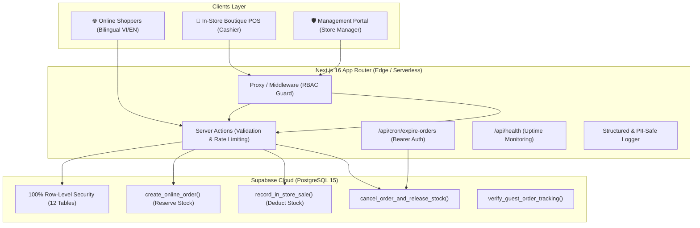

# Hoi An Eyewear — Omnichannel E-Commerce & Retail POS Platform

[](https://github.com/nguyenlpn2015/hoian-eyewear/actions/workflows/ci.yml)
[](https://nextjs.org/)
[](https://react.dev/)
[](https://www.typescriptlang.org/)
[](https://supabase.com/)
[](https://tailwindcss.com/)
[](LICENSE)

An enterprise-grade, omnichannel eyewear e-commerce platform and in-store Point of Sale (POS) application built with **Next.js App Router**, **TypeScript**, **Tailwind CSS**, and **Supabase (PostgreSQL, Auth, Storage)**.

Deployed live on Vercel: **[https://hoian-eyewear.vercel.app](https://hoian-eyewear.vercel.app)**

---

## 🏛️ System Architecture



---

## ✨ Key Engineering Highlights

### 1. Shared Real-Time Omnichannel Inventory
- **Single Source of Truth:** In-store POS cashier sales immediately decrement `quantity_on_hand`, while online checkouts atomically increment `quantity_reserved`.
- **Constraint Enforcement:** Database-level invariant `quantity_on_hand >= quantity_reserved` guarantees zero overselling across physical and digital sales channels.

### 2. High-Concurrency & Deadlock Prevention
- **Pessimistic Locking:** Critical inventory balances are locked using PostgreSQL `FOR UPDATE` clauses during transactions.
- **Deterministic Sort Ordering:** Variant IDs in multi-item carts are systematically sorted (`ORDER BY variant_id ASC`) prior to acquisition, mathematically eliminating database deadlocks under high concurrent traffic.

### 3. Hardened PostgreSQL Security Architecture
- **100% Row-Level Security (RLS):** All 12 domain tables enforce strict RLS policies. Direct read/write access to customer orders, profiles, and audit trails is restricted strictly to authenticated staff.
- **Search Path Hijacking Protection:** All `SECURITY DEFINER` procedures explicitly declare `SET search_path = public, pg_temp;` to mitigate privilege escalation vectors.
- **Role-Based Access Control (RBAC):**
  - `CASHIER`: Restricted solely to `/admin/pos` for retail transactions.
  - `STORE_MANAGER`: Authorized for product catalog management, manual stock adjustments, order refunds, and bank verification.

### 4. Background Job Automation & Fail-Closed Cron
- **24-Hour VietQR Expiration:** Unpaid bank transfer orders are automatically identified and cancelled after 24 hours, releasing reserved inventory back to the warehouse.
- **Fail-Closed Security:** The `/api/cron/expire-orders` endpoint enforces Bearer token validation with strict fail-closed rejection if `CRON_SECRET` is missing.

### 5. Privacy by Design & Zero-PII Observability
- **Two-Factor Guest Tracking:** Order tracking requires both `orderRef` and the last 4 digits of the customer's phone number, rendering data with masked customer names, phones, and addresses.
- **Sanitized Structured Logging:** High-performance JSON logger automatically intercepts and redacts sensitive credentials, JWTs, phone numbers, and full names before emitting to Vercel Log Drains.

---

## 🛠️ Technology Stack

| Layer | Technologies |
| :--- | :--- |
| **Framework** | Next.js 16.4.2 (App Router, Server Actions, Partial Prerendering) |
| **Language** | TypeScript 5 (Strict Mode enabled) |
| **UI & Styling** | React 19, Tailwind CSS v4, Lucide React, Plus Jakarta Sans & Playfair Display |
| **Backend & DB** | Supabase (PostgreSQL 15, Supabase SSR Clients, PostgREST, Row-Level Security) |
| **CI/CD** | GitHub Actions (`ubuntu-latest`, Node.js 22, native runner) |
| **Hosting** | Vercel Serverless & Edge Network |
| **Security** | HTTP Security Headers, In-Memory Sliding-Window Rate Limiter, PII Redaction |

---

## 🚀 Getting Started

### Prerequisites
- Node.js 22.x or later
- npm 10.x or later
- Supabase account (or local Docker Supabase CLI)

### Installation

1. **Clone the repository:**
   ```bash
   git clone https://github.com/nguyenlpn2015/hoian-eyewear.git
   cd hoian-eyewear
   ```

2. **Install dependencies:**
   ```bash
   npm ci
   ```

3. **Configure Environment Variables:**
   ```bash
   cp .env.example .env.local
   ```
   Fill in your Supabase project credentials in `.env.local`:
   ```ini
   NEXT_PUBLIC_SUPABASE_URL=https://your-project-id.supabase.co
   NEXT_PUBLIC_SUPABASE_ANON_KEY=your-anon-key
   SUPABASE_SERVICE_ROLE_KEY=your-service-role-key
   NEXT_PUBLIC_APP_URL=http://localhost:3000
   CRON_SECRET=your-random-32-char-cron-secret
   ```

4. **Run Database Migrations:**
   Apply migrations located in `supabase/migrations/` via the Supabase CLI or SQL Editor:
   - `20261016000000_init_hoian_eyewear.sql`
   - `20261017000000_security_hardening.sql`

5. **Start Development Server:**
   ```bash
   npm run dev
   ```
   Open [http://localhost:3000](http://localhost:3000) in your browser.

---

## 🧪 Testing & Code Quality

The project includes an automated regression test suite covering schema constraints, inventory race conditions, idempotency, rate limiting, and RBAC authorization:

```bash
# Run automated regression test suite (16 tests)
npm test

# Run ESLint quality audit
npm run lint

# Next.js production build verification
npm run build
```

---

## 📄 License

This project is licensed under the [MIT License](LICENSE).
